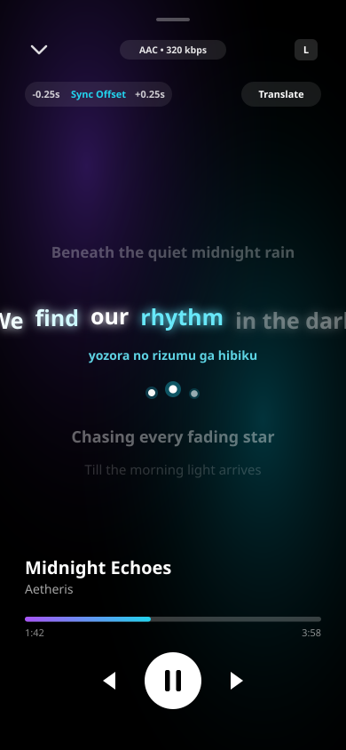

# Nevera

<p align="center">
  
</p>

<p align="center">
  <strong>Pemutar Musik Audiophile Android — OLED Minimalism, 64-bit C++17 Studio DSP, Lossless Server Streaming &amp; Lirik Karaoke 120fps</strong><br/>
  Versi <code>2.0.0</code> • Package: <code>com.nevera.corporation</code>
</p>

---

## Tampilan Aplikasi (`v2.0.0` UI Showcase)

<p align="center">
  
  &nbsp;&nbsp;
  
  &nbsp;&nbsp;
  
</p>

---

## Fitur Utama `v2.0.0`

### 1. Nevera Studio DSP — Mesin Audiophile Native C++17 64-bit
- **10-Band Parametric Equalizer (64-bit Double-Precision Biquad)** langsung di jalur PCM `ExoPlayer` (`32-bit Float` output) dengan grafik kurva respons frekuensi interaktif secara real-time (`31 Hz – 16 kHz`).
- **AutoEQ IEM / Headphone Presets + Impor `.txt`**: 14 preset Studio & AutoEQ (*Harman 2019 IE, Moondrop Chu II, Truthear Hexa, KZ ZSN Pro, Sony WH-1000XM5, AirPods Pro 2, Sennheiser HD 600*) plus parser impor file ParametricEQ `.txt` (`autoeq.app` / `squig.link`).
- **BS2B Headphone Crossfeed, M/S Stereo Width, L/R Balance & Tube Warmth**: Mengurangi kelelahan telinga saat memakai IEM/headphone dengan *soundstage* ala monitor studio.
- **EBU R128 Loudness Normalization (`-14 LUFS`) & True-Peak Limiter (`-0.3 dBFS`)**: Volume stabil tanpa *clipping* dan menjaga dinamika musik tetap utuh.
- **Bit-Perfect Direct Bypass & Android 14+ USB-DAC Exclusive**: Matikan seluruh pemrosesan DSP dengan satu sakelar untuk jalur PCM murni; mendukung negosiasi `MIXER_BEHAVIOR_BIT_PERFECT` pada USB-DAC di Android 14+.
- **Per-Device Auto Audio Profile & Live Audio Signal Path Inspector**: Otomatis beralih profil DSP saat pindah antara *USB-DAC, Wired IEM, Bluetooth,* dan *Speaker HP*, serta ketuk badge audio di *Now Playing* untuk melihat diagram jalur sinyal (*Source → DSP → Output*).

### 2. Streaming Kualitas Studio & Lossless Tanpa Wajib Unduh
- **Smart Queue Prefetch Cache**: Otomatis melakukan *pre-buffer* 2 lagu berikutnya di antrean ke LRU cache sementara (hingga 2 GB) agar transisi lagu *gapless* dan instan tanpa memenuhi penyimpanan dengan file permanen.
- **Personal Lossless Server Streaming (Subsonic / OpenSubsonic & WebDAV / HTTP)**: Hubungkan server **Navidrome, Jellyfin (Subsonic), Gonic, atau folder NAS WebDAV** untuk *streaming* langsung **FLAC / WAV / ALAC / Hi-Res 24-bit** (`format=raw`) dari tab **Servers**, bahkan otomatis *upgrade* lagu katalog ke versi FLAC dari server pribadimu.
- **Master Studio Stream Matching & Local Hi-Res Scanner**: Memprioritaskan audio master studio bitrate tertinggi (menghindari *rip* video musik berisik) dan mengenali format lokal `FLAC / WAV / ALAC / Opus`.

### 3. Mesin Lirik AI, Karaoke 120fps & Lyric Share Card
- **10+ Jalur Sumber Lirik Bertiming Paralel**: Prioritas *word/syllable-sync* untuk lagu global maupun Asia.
- **Karaoke *Glow &amp; Bounce Wave* Fokus Tengah**: Bebas scroll &amp; bebas blur, spasi kata utuh tanpa terpecah, plus animasi 3 titik (`• • •`) progresif saat jeda menjelang vokal.
- **Mode Dual-Line (Asli + Romaji / Terjemahan) &amp; OLED Lyric Share Card**: Pilih 1–4 baris lirik dan buat poster OLED 1080×1350 dengan sampul album siap bagikan langsung ke media sosial.

### 4. Visualizer Bass/Treble, Haptics, Speed/Pitch Studio &amp; Recap
- **Equalizer Spektrum C++17 FFT 512-Point + Spot Cahaya Blur Audio-Reaktif**: Tersinkronisasi latensi speaker otomatis, ditambah **Beat Music Haptics** opsional mengikuti hentakan bass.
- **Speed &amp; Pitch Studio (`432 Hz` Tuning, Slowed, Nightcore)**, **Sleep Timer dengan *Fade-Out* 10 detik &amp; *Akhir Lagu Ini***, **Queue Reorder &amp; Simpan ke Playlist**, serta **Nevera Recap** statistik dengar lokal privat.

---

## Teknologi Inti

| Komponen | Stack |
|---|---|
| **UI &amp; Animasi** | Kotlin, Jetpack Compose Material 3, Haze Frosted Glass, AGSL `RuntimeShader`, 120fps `Canvas` |
| **Native Studio DSP** | C++17 JNI (`libnevera_native.so`): 64-bit Biquad PEQ, BS2B Crossfeed, EBU R128, Limiter, 512-pt Radix-2 FFT |
| **Playback &amp; Output** | AndroidX Media3 (`ExoPlayer`, `MediaLibraryService`, `32-bit Float AudioSink`, `CacheWriter`, Android 14 USB Bit-Perfect) |
| **Lossless Network &amp; Lyrics** | OkHttp Subsonic/OpenSubsonic &amp; WebDAV Client, Ktor, Kotlinx Serialization, Parallel Timed Lyric Racing |

---

## Build dari Source

```bash
git clone https://github.com/bagzvfx/Nevera.git
cd Nevera
./gradlew testDebugUnitTest assembleDebug
```

> APK debug hasil build berada di `app/build/outputs/apk/debug/app-debug.apk`.
