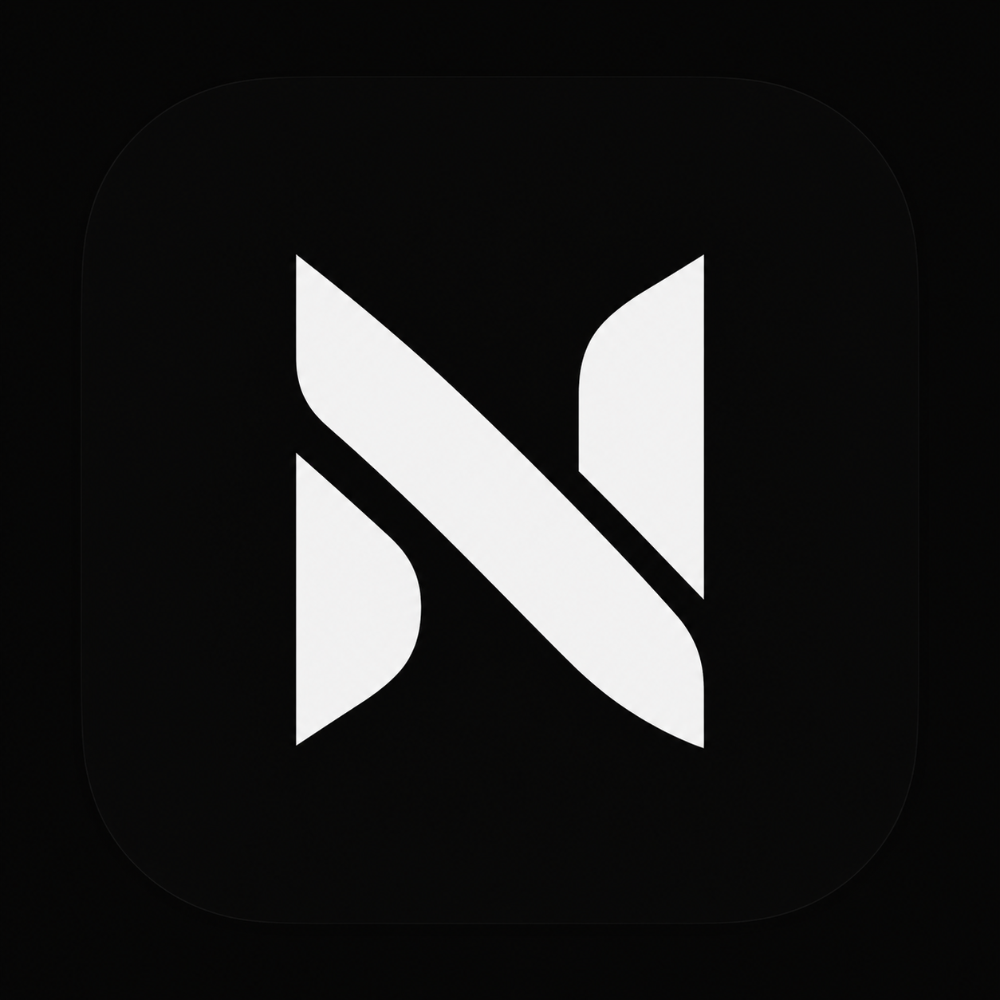

# Nevera

<p align="center">
  
</p>

<p align="center">
  <strong>Android Music Client — Smooth Editorial UI/UX, Native C++17 Mastering &amp; Bass/Treble Glow, Auto-Romaji, Floating Lyrics Overlay &amp; Hi-Res Lossless Audio</strong><br/>
  Version <code>0.1-beta</code> • Package: <code>com.nevera.corporation</code>
</p>

---

## Highlights (v4.0.0)
- **Local Playback History & Multi-Script Lyric Reading**: Playback history is recorded locally on-device with no sign-in required, and lyrics get automatic Latin reading lines — Romaji for Japanese, Romanization for Korean, and Pinyin for Chinese.
- **Clean Editorial UI/UX**: Dark, Light, and Pure OLED themes, Plus Jakarta Sans typography, sharp `4dp` precision surfaces, and hardware-style toggle switches.
- **Silky-Smooth Lyrics + Smart Auto-Romaji**: Fluid deceleration transitions with automatic Romaji detection for Japanese lyrics.
- **Floating Lyrics Overlay**: Draggable live lyrics overlay above other apps (`SYSTEM_ALERT_WINDOW`).
- **Native C++17 Mastering Boost & Limiter**: Cleanly boost loudness up to `+12 dB` past max device volume with soft-knee true-peak limiting.
- **Audio-Reactive Bass & Treble Glow**: Real-time C++17 2-band PCM analyzer driving smooth bass/treble lighting on the Now Playing screen.
- **Complete Streaming & Hi-Res Audio Engine**: YouTube Music, Hi-Res FLAC/ALAC, Bit-Perfect USB DAC, DSD, FFmpeg, Crossfade, Gapless, ONNX Automix, 12+ lyrics providers, Offline Downloads (`Music/Nevera`), Local Music, WebDAV/SMB, Spotify, Discord RPC, Last.fm/ListenBrainz, Listen Together, Android Auto, and Widgets.

## Build
```bash
./gradlew testProdDebugUnitTest assembleProdDebug
```

## License
Licensed under the **GNU General Public License v3.0** ([LICENSE](LICENSE)). Audio & streaming core derived from open-source BitChord (GPL-3.0).
