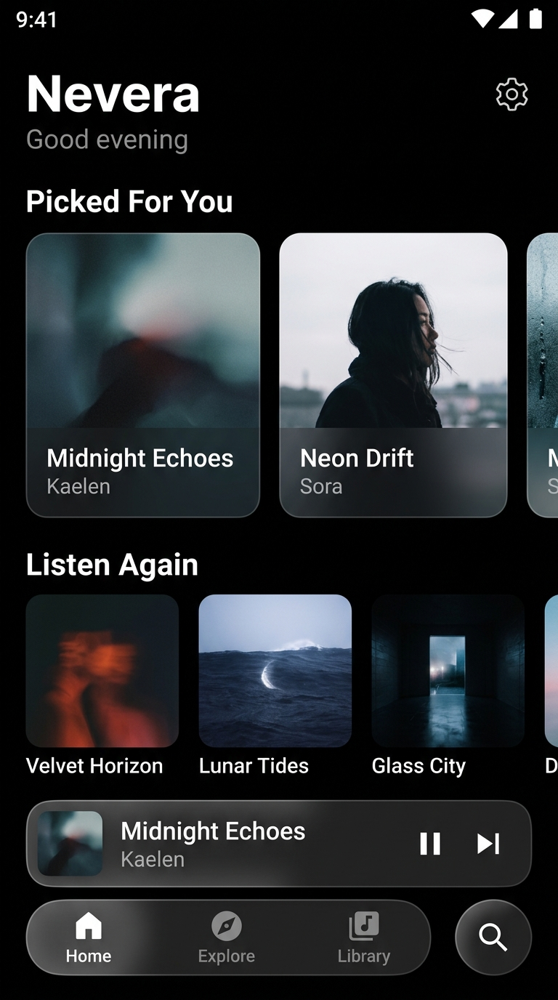
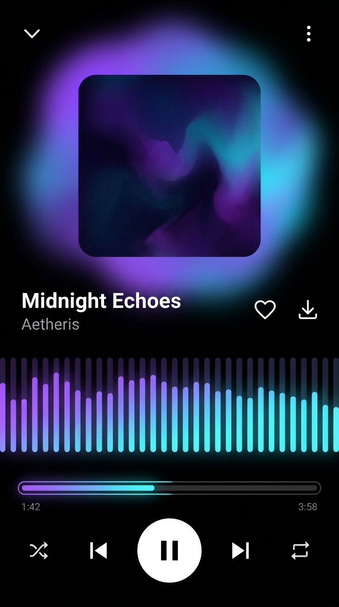

# Nevera

<p align="center">
  
</p>

<p align="center">
  <strong>Pemutar Musik Android Modern — OLED Minimalism, Lirik Karaoke 120fps &amp; DSP Native C++</strong><br/>
  Versi <code>1.0-beta</code> • Package: <code>com.nevera.corporation</code>
</p>

---

## Tampilan Aplikasi (`v1.0-beta` UI Showcase)

<p align="center">
  
  &nbsp;&nbsp;
  
  &nbsp;&nbsp;
  
</p>

---

## Fitur Utama

### 1. Mesin Lirik AI &amp; Karaoke Presisi 120fps
- **10+ Jalur Sumber Lirik Bertiming Paralel**: Balapan paralel berprioritas *word/syllable-sync* untuk kecepatan muat dan akurasi timing lintas lagu global maupun Asia.
- **Karaoke *Glow &amp; Bounce Wave* Tanpa Putus Spasi**: Perhitungan tata letak karakter utuh menjaga kerning dan spasi alami tetap sempurna sambil memberi efek pijar cahaya &amp; gelombang memantul halus di huruf/kata yang sedang dinyanyikan.
- **Fokus Tengah Layar Bebas Scroll &amp; Blur**: Baris lirik aktif dikunci tepat di tengah layar mengikuti vokal, dilengkapi animasi titik tiga (`• • •`) progresif saat jeda lagu menjelang masuknya vokal.
- **Romaji Otomatis &amp; Terjemahan On-Demand**: Penyetelan cepat timing (`-0.25s / +0.25s`), konversi Hepburn Romaji C++17 native untuk lagu berbahasa Jepang, serta terjemahan instan menjaga timestamp karaoke.

### 2. Audio Visualizer &amp; Latar Album Reaktif Bass/Treble
- **Equalizer Spektrum C++17 FFT 512-Point**: Dijalankan non-destruktif lewat `Media3 AudioProcessor` dengan kompensasi latensi output speaker/headset otomatis sehingga bar bergerak selaras dengan suara yang terdengar.
- **Spot Cahaya Blur Audio-Reaktif**: Latar shader AGSL GPU (Android 13+) dan Canvas 120fps di belakang sampul album menyala terang-redup mengikuti energi **Bass** dan **Treble** secara real-time.

### 3. Pemutaran Multi-Sumber, Antrean Cerdas, &amp; Integrasi Sistem Android
- **Smart Up-Next Queue**: Memilih lagu dari **Telusuri** membangun antrean lagu serupa yang relevan, menyaring duplikat dan varian berisik (*slowed/karaoke*), serta menjaga variasi artis.
- **Kualitas Stream Adaptif**: Resolusi audio adaptif hingga **320kbps AAC** &amp; cache lokal pintar serta dukungan impor playlist dan lagu lokal perangkat (`MediaStore`).
- **System MediaSession (`Media3`)**: Mendukung kontrol notifikasi *MediaStyle*, *lock screen*, *MediaButtonReceiver*, dan standar pil media sistem Android dengan loader artwork berkecepatan tinggi.
- **Interaksi Sentuh Presisi 120fps**: *Harmonic VFX Engine* zero-allocation yang merespons tepat di posisi ujung jari pada setiap tombol dan permukaan layar.

---

## Teknologi Inti

| Komponen | Stack |
|---|---|
| **UI &amp; Animasi** | Kotlin, Jetpack Compose Material 3, Haze Frosted Glass, AGSL `RuntimeShader`, 120fps `Canvas` |
| **Native Audio &amp; Phonetics** | C++17 JNI (`libnevera_native.so`): 512-pt Radix-2 FFT, Spectral Flux, Romaji &amp; Mora Aligner |
| **Playback Engine** | AndroidX Media3 (`ExoPlayer`, `MediaLibraryService`, `BaseAudioProcessor`, `SimpleCache`) |
| **Lirik &amp; Pencarian** | OkHttp, Ktor Client, Kotlinx Serialization, Parallel Timed Lyric Racing |

---

## Build dari Source

```bash
git clone https://github.com/bagzvfx/Nevera.git
cd Nevera
./gradlew testDebugUnitTest assembleDebug
```

> APK debug hasil build berada di `app/build/outputs/apk/debug/app-debug.apk`.
